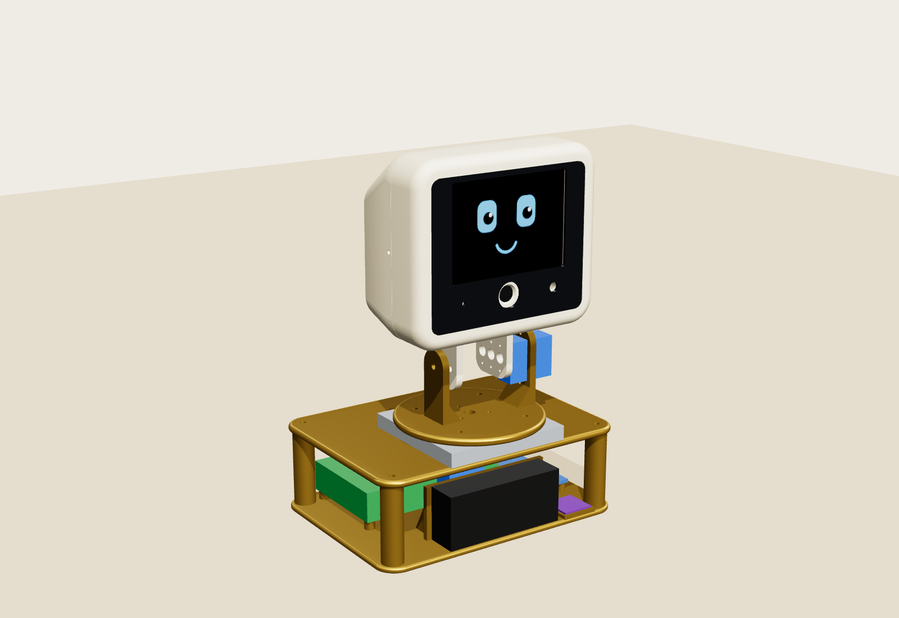

# Riley's printed body

A closed CRT-monitor head (retro beige, every edge rounded, with one smooth black panel over
its whole face, and the camera hidden behind it like a laptop's webcam) on an open desktop-case base (gold), joined by a neck that turns (pan) and nods (tilt). Every part is made by `make_parts.py` from the sizes at
the top of that file, so a wrong size is a one-line fix, not a redesign.



## 1. Before you order: measure these

The parts are only as good as these numbers. Each is marked `MEASURE` in `make_parts.py`.
Measure with calipers (a ruler to 0.5 mm will do), change the number, run
`python docs/print/make_parts.py` again, and check it still says nothing "DOESN'T FIT".

| What | Number in `make_parts.py` | How |
|---|---|---|
| Screen: corner holes | `SCREEN_HOLES` | centre of a corner hole to the board's side edge, and to its top edge |
| Screen: glass depth | `SCREEN_GLASS_DEPTH` | front of the glass to the front of the green board (beside the glass) |
| Round servo horn | `HORN` | across; centre to its screw holes; its flat face above the shaft's tip when pushed on |
| Turntable bearing | `BEARING` `bottom_holes`, `top_holes` | centre of the bearing to the centre of a screw hole, on each plate |
| Servo board (PCA9685) | `SERVO_BOARD_HOLES` | its mounting holes apart, across and along |
| Speaker | `SPEAKER_HOLES` | its two end holes apart, centre to centre |
| Mic board | `MIC_BOARD` | across |
| Camera lens | `CAMERA_LENS` | height of the lens above the camera board |
| Camera lens position | `CAMERA_LENS_FROM_TOP` | centre of the lens to the board's top edge: it decides where the hole goes |

The screen and the servo were measured already. The Pi 4 and Camera Module 3 sizes are
the official ones.

## 2. The parts

| File (in `stl/`) | Size (mm) | Colour | Lay it on the bed | Supports |
|---|---|---|---|---|
| `head_front.stl` | 112 × 96 × 27 | beige | face down (as the file is) | none |
| `face_plate.stl` | 93.5 × 77.5 × 1.6 | black (gloss if they have it) | flat | none |
| `head_back.stl` | 112 × 128 × 49 | beige | back down (as the file is) | under the two lugs only |
| `base_frame.stl` | 150 × 110 × 46 | gold | floor down | none |
| `base_deck.stl` | 150 × 110 × 9.3 | gold | top down (blocks up, as the file is) | none |
| `drive_disc.stl` | 82 × 82 × 46.5 | gold | disc down | none |
| `horn_hub.stl` | 28 × 28 × 8 | gold | either flat face | none |

About 270 cm³ of plastic in all. Every part fits a 180 mm printer.

**Settings for whoever prints it:** PLA (or PETG for a little more toughness), 0.2 mm layers,
at least 3 walls, 20 % infill. The shells are 2.4 mm thick, so they come out solid. Holes for
screws are printed undersized on purpose: the screws cut their own thread.

**Colours:** retro beige (or ivory) for the head; black for the face plate (it
hides the screen's edges, so the face looks like one panel); gold **silk** PLA for the base and
neck, which keeps the brass look. Any colours work: the files don't care.

## 3. Getting it printed

* **Someone local** (a makerspace, a friend, a library printer, or a local maker found on
  Craftcloud or eBay): easiest for silk gold and beige, and they can reprint one part if
  it's wrong. Send them this page and the `stl` folder.
* **Online service:** upload the STLs, choose FDM and PLA. Craftcloud compares UK printers;
  JLC3DP and PCBWay are cheap but ship from China (1 to 2 weeks), and offer fewer colours.
* **Cost** is a guess until you get quotes: roughly £30 to £70 for the lot in FDM.

## 4. Screws and bits to buy

| What | How many | For |
|---|---|---|
| M2 × 6 mm self-tapping screws (pan head) | 30 (17 used) | screen 4, camera 4, both servos' tabs 4, head halves 2, hub 3 |
| M2.5 × 6 mm self-tapping screws | 10 (8 used) | Pi 4, servo board 4 |
| M3 × 10 mm self-tapping screws | 4 | the deck onto the pillars |
| M3 × 16 mm bolt, M3 nylon lock nut, 2 washers | 1 set | the head's hinge |
| M3 bolts and nuts to suit your bearing | 8 | bearing to deck, disc to bearing |
| Double-sided foam tape | a strip | the amp in its tray |

The servo horns' own little screws hold the horns to the hub and to the head.

## 5. Putting it together (short version)

1. **Base:** Pi on its 4 standoffs (USB and network to the RIGHT, pins at the BACK), servo
   board on its 4, amp in its tray, speaker screwed to its bracket through rubber washers.
2. **Pan:** centre the pan servo first (the code does it). Push its case up into the pocket
   under the deck and screw its tabs to the two blocks. Screw the bearing onto the deck.
3. **Hub and disc:** screw the round horn to the bottom of the hub, the hub to the disc
   (3 screws), then the disc onto the bearing's top plate. The horn's centre screw goes in
   last, through the hole in the middle of the disc.
4. **Head:** glue the black face plate into the recess on the front (a thin line of clear
   glue round its edge, window lined up with the screen's). Screen onto its 4 bosses from behind. Under it, in one row: the mic into its
   ring on the left (foam behind it), the camera onto its 4 bosses in the middle (lens into the
   round hole, ribbon folded down and back along the floor), the light into its sleeve on the
   right. Join the two halves (2 screws in the sides).
5. **Balance:** hold the finished head by each of the 3 hinge holes in turn on a pencil; use
   the one it balances best on.
6. **Tilt:** centre the tilt servo, screw it into the right arm (body sticking out). Screw the
   second round horn to the head's right lug at the chosen hole, push it onto the servo's
   shaft, centre screw in. Bolt the left lug to the left arm (washer either side, lock nut
   just snug: the head must swing freely).

## 6. Changing anything

```bash
pip install -r docs/print/requirements.txt
python docs/print/make_parts.py            # rebuilds every STL and checks the fit
python docs/print/make_parts.py check      # only the fit check
node docs/print/render.js                  # the pictures (needs Playwright and three.js)
```
